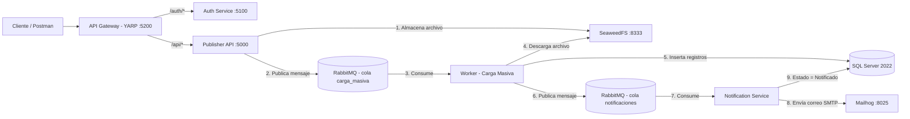

# 🏗️ Acity Challenge — Sistema de Carga Masiva de Productos


Sistema distribuido de **carga masiva de productos** basado en microservicios con .NET 8, Clean Architecture, CQRS y mensajería asíncrona. El flujo completo va desde la subida de un archivo Excel hasta la notificación por correo, con trazabilidad de estados en todo el proceso.

---

## 🏗️ Arquitectura



### Componentes

| Componente              | Tecnología       | Responsabilidad                                                               |
| ----------------------- | ---------------- | ----------------------------------------------------------------------------- |
| **ApiGateway**          | YARP + JWT       | Punto de entrada único, validación de token y enrutamiento                    |
| **AuthService**         | .NET 8 + MediatR | Autenticación y emisión de JWT (Microservicio 0)                              |
| **Publisher.Api**       | .NET 8 + CQRS    | Recepción del Excel, trazabilidad y publicación en cola (Microservicio 1)     |
| **Worker**              | .NET 8 + EPPlus  | Procesamiento asíncrono del Excel y validaciones de negocio (Microservicio 2) |
| **NotificationService** | .NET 8 + MailKit | Envío de correo y cierre del ciclo de estados (Microservicio 3)               |
| **RabbitMQ**            | 3.13             | Dos colas durables: `carga_masiva` y `notificaciones`                         |
| **SeaweedFS**           | S3-compatible    | Almacenamiento distribuido de archivos Excel                                  |
| **SQL Server**          | 2022             | Persistencia con stored procedures (Dapper)                                   |
| **Mailhog**             | -                | Servidor SMTP de pruebas con UI web                                           |

---

## 🧰 Stack tecnológico

- **Backend:** .NET 8, Clean Architecture, CQRS (MediatR), SOLID
- **Persistencia:** Dapper + Stored Procedures (SQL Server)
- **Mensajería:** RabbitMQ (mensajes persistentes, ACK manual, prefetch = 1)
- **Seguridad:** JWT Bearer (emisor y audiencia validados en Gateway)
- **Archivos:** SeaweedFS (API tipo S3)
- **Correo:** MailKit + MimeKit
- **DevOps:** Dockerfile multi-stage por servicio + docker-compose orquestado

---

## 🚀 Inicio rápido

### Requisitos

- Docker Desktop con Docker Compose v2
- Git

### 1. Clonar y levantar

```bash
git clone https://github.com/ialegre96/acity-challenge.git
cd acity-challenge
docker-compose up --build -d
```

> ⏱️ La primera ejecución tarda ~3-5 minutos. El contenedor `db-init` espera a SQL Server y ejecuta `scripts/init.sql` automáticamente (crea BD, tablas y stored procedures).

### 2. Verificar que todo esté arriba

```bash
docker-compose ps
```

### 3. Servicios expuestos

| Servicio                     | URL                           | Credenciales  |
| ---------------------------- | ----------------------------- | ------------- |
| API Gateway (entrada)        | http://localhost:5200         | -             |
| Auth Service (Swagger)       | http://localhost:5100/swagger | -             |
| Publisher API (Swagger)      | http://localhost:5000/swagger | -             |
| RabbitMQ Management          | http://localhost:15672        | admin / admin |
| Mailhog (bandeja de correos) | http://localhost:8025         | -             |
| SeaweedFS UI                 | http://localhost:9333         | -             |

### 🔐 Credenciales de prueba

| Campo    | Valor      |
| -------- | ---------- |
| Usuario  | `admin`    |
| Password | `admin123` |

---

## 📡 Endpoints (vía Gateway)

### 1. Login — `POST /auth/login`

```json
{
  "username": "admin",
  "password": "admin123"
}
```

**Respuesta 200:**

```json
{
  "token": "eyJhbGciOiJIUzI1NiIsInR5cCI6..."
}
```

### 2. Subir Excel — `POST /api/Excel/upload`

- **Headers:** `Authorization: Bearer {token}`
- **Body:** `form-data` con campo `file` (archivo .xlsx)

**Respuesta 200:**

```json
{
  "fileId": "7a9e89bd-1f84-415f-9af5-de678da8a801"
}
```

### 3. Estado de una carga — `GET /api/Excel/status/{fileId}`

- **Headers:** `Authorization: Bearer {token}`

**Respuesta 200:**

```json
{
  "fileId": "7a9e89bd-1f84-415f-9af5-de678da8a801",
  "fileName": "carga_masiva_productos.xlsx",
  "filePath": "http://seaweedfs:8333/excel-files/4a221819-....xlsx",
  "status": 4,
  "createdAt": "2026-11-02T23:30:29.45",
  "processedAt": "2026-11-02T23:30:31.11",
  "message": null
}
```

### 4. Historial de cargas — `GET /api/Excel/history`

- **Headers:** `Authorization: Bearer {token}`

---

## 🔄 Ciclo de vida del archivo

| Valor | Estado     | Descripción                                |
| ----- | ---------- | ------------------------------------------ |
| 0     | Pendiente  | Registro creado al recibir el archivo      |
| 1     | EnProceso  | Worker descargó y está procesando el Excel |
| 2     | Cargado    | Registros válidos insertados en BD         |
| 3     | Finalizado | Procesamiento cerrado con métricas         |
| 4     | Notificado | Correo enviado y ciclo completado          |
| 5     | Fallido    | Error de validación o procesamiento        |

---

## 📄 Formato esperado del Excel

| Periodo    | CodigoProducto | NombreProducto | Precio |
| ---------- | -------------- | -------------- | ------ |
| 2025-03-01 | P0117          | Producto A     | 150.00 |
| 2025-03-01 | P0016          | Producto B     | 200.00 |

- **Fila 1:** encabezados. **Datos desde la fila 2.**
- `Periodo` (columna A) define el periodo de la carga completa.

### Reglas de negocio implementadas

1. **Duplicidad por Periodo:** si ya existe una carga del mismo periodo en estado `Cargado`, `Finalizado` o `Notificado`, la nueva carga se **rechaza**. Si está `Pendiente` o `EnProceso`, se **bloquea** (evita cargas simultáneas).
2. **Duplicidad por Código:** un `CodigoProducto` ya existente en BD para el mismo periodo **no se registra** y se reporta como _Existente_.
3. **Duplicidad interna:** códigos repetidos dentro del mismo archivo se descartan.
4. **Filas vacías:** se omiten sin registrarse.
5. **Columnas vacías:** se aplican valores por defecto (`Sin nombre`, precio `0`).
6. **Auditoría:** todos los registros rechazados se guardan en la tabla `AuditoriaFallidos` con fila, código y motivo.

---

## 🧪 Guía de prueba end-to-end

1. **Login:** `POST /auth/login` → copia el token.
2. **Upload:** `POST /api/Excel/upload` con un .xlsx → copia el `fileId`.
3. **Estado:** `GET /api/Excel/status/{fileId}` → observa el avance `0 → 4`.
4. **Correo:** abre http://localhost:8025 y verifica el resumen de la carga.
5. **Colas:** en http://localhost:15672 revisa `carga_masiva` y `notificaciones`.
6. **Auditoría:** consulta los rechazos:
   ```sql
   SELECT * FROM AuditoriaFallidos ORDER BY FechaRegistro DESC;
   ```

---

## 🗂️ Estructura del proyecto

```
AcityChallenge/
├── ApiGateway/            # YARP + validación JWT
├── AuthService/           # Microservicio 0: login y emisión de JWT
├── Publisher/             # Microservicio 1 (Clean Architecture)
│   ├── Publisher.Api/
│   ├── Publisher.Application/
│   ├── Publisher.Domain/
│   └── Publisher.Infrastructure/
├── Worker/                # Microservicio 2: procesamiento asíncrono
├── NotificationService/   # Microservicio 3: correo + estado final
├── scripts/
│   └── init.sql           # BD, tablas y SPs (ejecutado por db-init)
├── docker-compose.yml     # Orquestación completa (9 servicios)
└── AcityChallenge.sln
```

---

## 🛠️ Solución de problemas

| Problema                   | Solución                                                                                                               |
| -------------------------- | ---------------------------------------------------------------------------------------------------------------------- |
| `db-init` termina en error | Revisa `docker logs acity_db_init`. Si SQL Server aún no estaba listo, ejecuta `docker-compose up -d db-init` de nuevo |
| 401 en endpoints `/api/*`  | El token expira en 2 h: vuelve a hacer login                                                                           |
| No llega el correo         | Verifica que `acity_mailhog` esté corriendo y revisa http://localhost:8025                                             |
| Puerto ocupado             | Cambia el mapeo en `docker-compose.yml` (ej. `"5201:8080"`)                                                            |

---

## 👤 Autor

**Iesus Alegre** — [@ialegre96](https://github.com/ialegre96)

Reto técnico para postulación **Desarrollador Fullstack Senior**.
